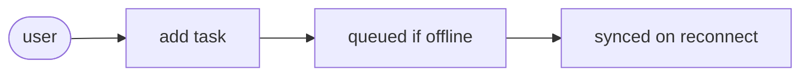
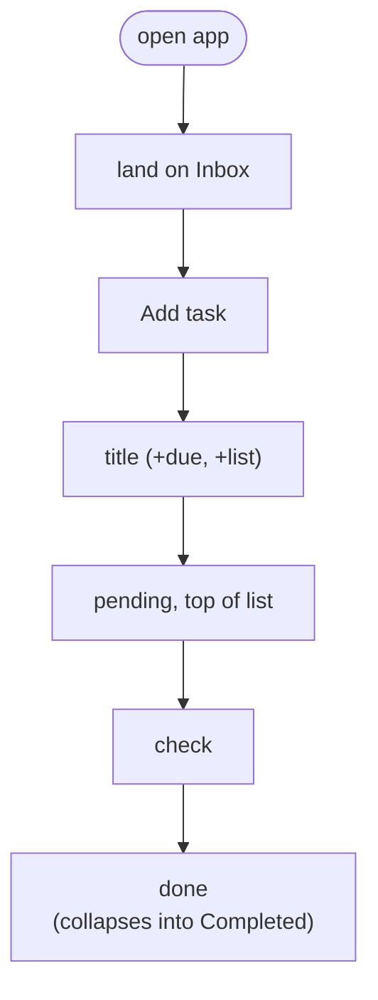
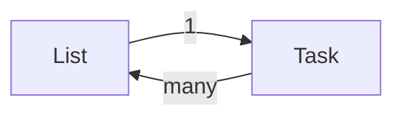
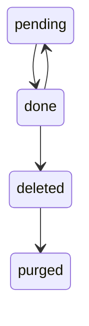
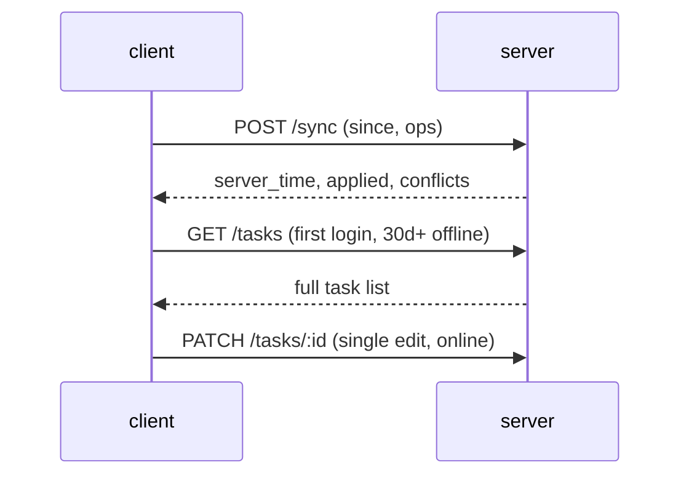
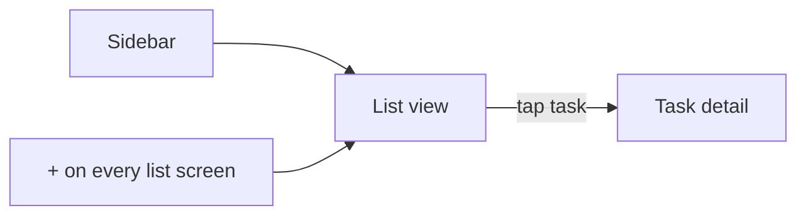

# To-Do List App — Spec · beautyfact

> Visual version of [todo-list-spec.md](todo-list-spec.md) (original
> untouched). Nothing omitted. Every section links to its raw source lines.

**Legend:** 🔗 source line · 📌 rule · ⚠️ edge case · 🎯 expected result ·
💬 UI text · 🧭 decision

## 0. 👀 What to check

🔗 Source: [todo-list-spec.md L142–L166](todo-list-spec.md#L142)

Two things decide most of the rest: the sync model is **last-write-wins
per record** (RF-09), not per field, and deleting a list never deletes
its tasks (RF-05/RF-07). The conflict walkthrough in «**Edge cases**»
is the clearest place to see both rules collide.

| Rule | Effect |
| --- | --- |
| Sync | Last write wins, whole record, by `updated_at` |
| List delete | Tasks move to Inbox, never deleted |
| Both meet | 🧭 conflict walkthrough, section 9 |

## 1. 🎯 Summary

🔗 Source: [todo-list-spec.md L3–L12](todo-list-spec.md#L3)

A single-user to-do app, offline-first, syncing across devices once the
connection returns.



- 🎯 95% of offline tasks sync in ≤ 5s of reconnecting.
- 🎯 < 1% of syncs produce a duplicate or lost task.
- 🎯 First task created in < 10s for a new user.

## 2. 🧭 Scope

🔗 Source: [todo-list-spec.md L14–L28](todo-list-spec.md#L14)

| In | Out |
| --- | --- |
| Create / edit / complete / delete | Sharing lists or tasks |
| Lists («**Work**», «**Personal**») | Sub-tasks / checklists |
| Due dates and reminders | Calendar integrations |
| Offline use + background sync | |

- 📌 Platforms: iOS, Android, responsive web.
- 📌 Stack: Node.js backend, React Native (mobile), React (web).

## 3. 🔄 Main flow

🔗 Source: [todo-list-spec.md L30–L44](todo-list-spec.md#L30)



- 📌 Secondary: new list from the sidebar with a color.
- 📌 Secondary: edit title/due date/list from the task's detail view.

## 4. 📋 Functional requirements

🔗 Source: [todo-list-spec.md L46–L66](todo-list-spec.md#L46)

Ten requirements in three groups: tasks, lists, offline/sync.

| Group | Count | Requirements |
| --- | --- | --- |
| Tasks | ▓▓▓▓ | RF-01 to RF-04 |
| Lists | ▓▓▓ | RF-05 to RF-07 |
| Offline, sync | ▓▓▓ | RF-08 to RF-10 |

- 📌 RF-01 (M) Create task: title required, due date and list optional
  🔗 [L49](todo-list-spec.md#L49)
- 📌 RF-02 (M) Edit any task field after creation 🔗 [L51](todo-list-spec.md#L51)
- 📌 RF-03 (M) Mark task done / undone 🔗 [L52](todo-list-spec.md#L52)
- 📌 RF-04 (M) Delete task, reversible 10s via «**Undo**» toast
  🔗 [L53](todo-list-spec.md#L53)
- 📌 RF-05 (M) Create, rename, delete a list 🔗 [L57](todo-list-spec.md#L57)
- 📌 RF-06 (S) Assign a color to a list 🔗 [L58](todo-list-spec.md#L58)
- 📌 RF-07 (M) «**Inbox**» cannot be deleted 🔗 [L59](todo-list-spec.md#L59)
- 📌 RF-08 (M) All operations work offline, queued 🔗 [L62](todo-list-spec.md#L62)
- 📌 RF-09 (M) Queue syncs automatically on reconnect, no user action
  🔗 [L63–L64](todo-list-spec.md#L63)
- 📌 RF-10 (S) Due-date reminder notification, if enabled
  🔗 [L65–L66](todo-list-spec.md#L65)

## 5. 📐 Non-functional requirements

🔗 Source: [todo-list-spec.md L68–L81](todo-list-spec.md#L68)

| Area | Requirement |
| --- | --- |
| Performance | List renders < 300ms up to 1,000 tasks |
| Offline | Fully usable, no operation blocks on network |
| Sync | Queue applies in ≤ 5s, in creation order |
| Security | HTTPS only, tasks scoped to the owning user |
| Accessibility | 44x44pt touch targets, screen-reader support |
| Compatibility | iOS 15+, Android 10+, last 2 browser versions |

## 6. 🧱 Data model

🔗 Source: [todo-list-spec.md L83–L101](todo-list-spec.md#L83)



| Entity | Fields |
| --- | --- |
| Task | `id`, `title`, `done`, `due_date`, `list_id`, `created_at`, `updated_at`, `deleted_at` |
| List | `id`, `name`, `color`, `is_default`, `created_at` |

- 📌 A list has many tasks; a task belongs to exactly one list.

### 🔄 Task lifecycle 🔗 [L94–L95](todo-list-spec.md#L94)



- 📌 A deleted list's tasks are reassigned to Inbox, never orphaned
  🔗 [L90–L92](todo-list-spec.md#L90)
- 📌 `list_id` is rewritten to Inbox if its list no longer exists, never
  left dangling 🔗 [L98–L100](todo-list-spec.md#L98)
- 📌 A `done` toggle never changes `due_date` 🔗 [L101](todo-list-spec.md#L101)

## 7. 🔌 Contracts / API

🔗 Source: [todo-list-spec.md L103–L120](todo-list-spec.md#L103)



- 📌 Deleted tasks stay soft-deleted for 30 days, then are purged 🔗 [L94–L95](todo-list-spec.md#L94)

- 📌 Error format: `{ error: { code, message } }` 🔗 [L117](todo-list-spec.md#L117)
- 📌 Conflicts resolved last-write-wins by `updated_at`; the losing edit
  comes back in `conflicts` so the client can flag it
  🔗 [L117–L120](todo-list-spec.md#L117)

## 8. 🖼️ Screens and UX

🔗 Source: [todo-list-spec.md L122–L140](todo-list-spec.md#L122)



```text
 ┌─────────────────────────────────────┐
 │ «List name»                    [+]  │
 │ [ ] Task title            due badge │
 │ [ ] Task title                      │
 │ ▼ Completed (N)                     │
 └─────────────────────────────────────┘
```

- 🖼️ Swipe left ──▶ 💬 «**Delete**» · swipe right ──▶ 💬 «**Edit**»
  🔗 [L134](todo-list-spec.md#L134)
- 🖼️ Completed tasks: 50% opacity, strikethrough title
  🔗 [L139–L140](todo-list-spec.md#L139)
- 📌 Pull to refresh forces a sync attempt; long-press multi-selects for
  bulk delete/move 🔗 [L136–L137](todo-list-spec.md#L136)

## 9. ⚠️ Edge cases

🔗 Source: [todo-list-spec.md L142–L166](todo-list-spec.md#L142)

Most complex case: the same task edited offline on two devices before
either syncs.

`[x]` edited · `[ ]` untouched

| Step | due_date | title | synced? | Note |
| --- | --- | --- | --- | --- |
| 1 A edits (offline) | [x] | [ ] | [ ] | |
| 2 B edits (offline) | [ ] | [x] | [ ] | |
| 3 A reconnects | [x] | [ ] | [x] | Server now = A |
| 4 B reconnects | [ ] | [x] | [x] | B wins whole record, A's `due_date` is lost ──▶ returned in `conflicts` |

- ⚠️ Last-write-wins is per **record**, not per field: B's sync
  overwrites A's due date even though B only touched the title
  🔗 [L151–L156](todo-list-spec.md#L151)
- ⚠️ Delete beats a stale edit: a task deleted offline is not
  resurrected by a later edit from another device
  🔗 [L159–L161](todo-list-spec.md#L159)
- ⚠️ A reminder still fires for a task completed moments earlier on
  another device but not yet synced locally 🔗 [L162–L164](todo-list-spec.md#L162)
- ⚠️ Deleting a pending task's list reassigns it to Inbox on sync,
  rather than failing 🔗 [L165–L166](todo-list-spec.md#L165)

## 10. 🎯 Acceptance criteria

🔗 Source: [todo-list-spec.md L168–L185](todo-list-spec.md#L168)

| Criterion | Covers |
| --- | --- |
| CA-01 Title only | RF-01 |
| CA-02 Delete with undo | RF-04 |
| CA-03 Create offline, sync | RF-08, RF-09 |
| CA-04 Inbox cannot delete | RF-07 |

- [ ] 🎯 **Create a task with only a title** (RF-01) 🔗 [L170–L172](todo-list-spec.md#L170)
  - WHEN the user adds a task with just a title, no due date or list
  - ──▶ THEN it appears in Inbox, pending, within 1s
- [ ] 🎯 **Delete with undo** (RF-04) 🔗 [L173–L178](todo-list-spec.md#L173)
  - WHEN the user deletes a task
  - ──▶ THEN it disappears immediately and 💬 «**Undo**» shows for 10s
  - ──▶ NOT removed from the server before the undo window closes
- [ ] 🎯 **Create offline, then sync** (RF-08, RF-09) 🔗 [L179–L182](todo-list-spec.md#L179)
  - WHEN the user creates 3 tasks offline, then regains the network
  - ──▶ THEN all 3 sync to the server within 5s
  - ──▶ NOT any task is duplicated or lost
- [ ] 🎯 **Inbox cannot be deleted** (RF-07) 🔗 [L183–L185](todo-list-spec.md#L183)
  - WHEN the user tries to delete the «**Inbox**» list
  - ──▶ THEN the delete option is disabled and nothing happens

## 11. ❓ Open questions

🔗 Source: [todo-list-spec.md L187–L191](todo-list-spec.md#L187)

- ❓ Q1 🔗 [L189–L190](todo-list-spec.md#L189): should reminders be
  configurable per task (e.g. «**30 min before**») or always fire
  exactly at the due time?
- ❓ Q2 🔗 [L191](todo-list-spec.md#L191): is there a limit on how many
  lists a single user can create?
