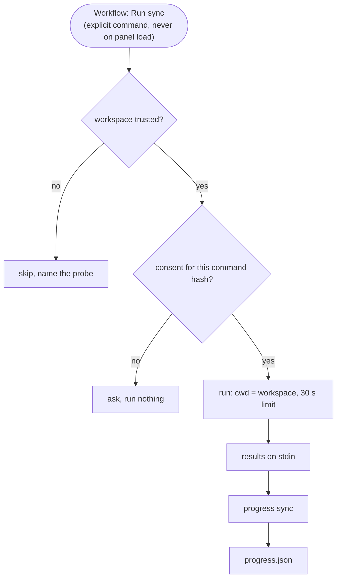

# Pattern: decisions with yes / no branches

Excerpt from a real `_beautyfact` file. Copy the shape, not the content.

## 6. 🔎 Probes and sync

🔗 Source: [design.md L75–L91](design.md#L75)

- 📌 Consent lives in VS Code workspace state; an edited command has a new hash and asks again.
- 📌 A plain CLI `sync` runs file probes only and names the skipped commands.
