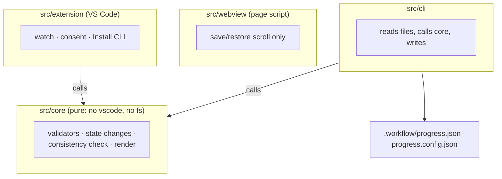

# Pattern: architecture as stacked layers that call each other

Excerpt from a real `_beautyfact` file. Copy the shape, not the content.

## 2. 🏗️ Architecture

🔗 Source: [D9 L36–L39](design.md#L36) · [D18 L95–L98](design.md#L95) · [D20 L106–L109](design.md#L106)

- 📌 The webview sends no messages; the extension ignores any it gets.
- 📌 Adapters live apart in `src/adapters`. Runtime dependencies: none.
