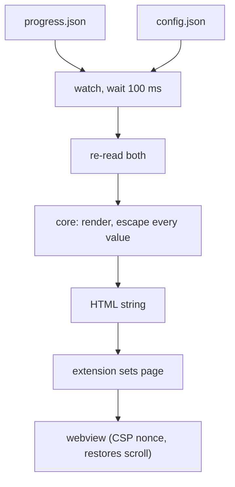

# Pattern: inputs merged, then a vertical chain

Excerpt from a real `_beautyfact` file. Copy the shape, not the content.

## 7. 🖥️ Panel

🔗 Source: [design.md L93–L102](design.md#L93)

The extension watches both files and redraws within about 100 ms of the last change. The page is plain escaped HTML built by `src/core`; the webview script only restores scroll.

