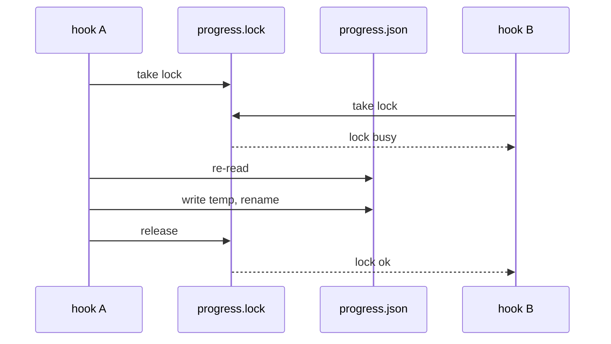

# Pattern: two actors and a shared resource over time

Excerpt from a real `_beautyfact` file. Copy the shape, not the content.

### 🔐 D14 + D15 · two parallel hooks, no lost update 🔗 [L66–L73](design.md#L66)

- 📌 Lock waits a few seconds; a lock older than 10 s is stale and replaced.
- 📌 Write goes to a temp file in `.workflow/`, then rename: no half-written file.
