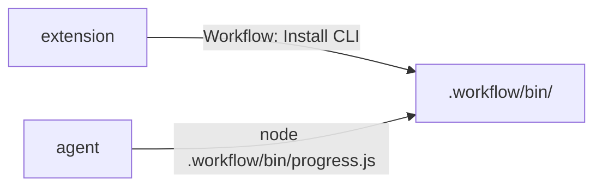
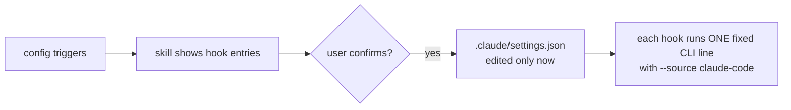

# Pattern: folder tree and a short chain of steps

Excerpt from a real `_beautyfact` file. Copy the shape, not the content.

## 8. 📦 Distribution and adapters

🔗 Source: [design.md L104–L113](design.md#L104)

```text
 .workflow/bin/
 ├── progress.js
 ├── core files
 └── version file
```



The extension copies the CLI into `.workflow/bin/` so agents have a stable path. Claude Code hooks are written only after you confirm, and each runs one fixed line, never text from an event.


